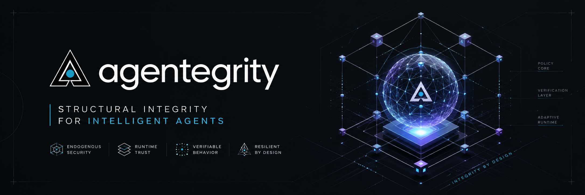
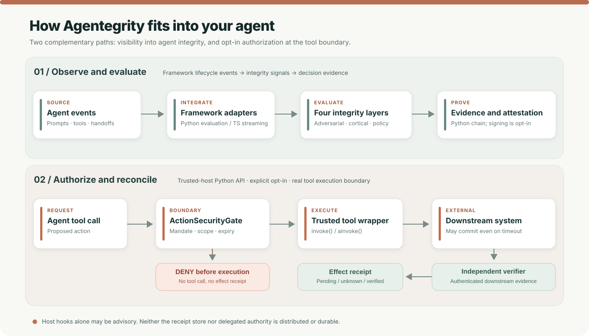

<p align="center">
  
</p>

<h1 align="center">Runtime integrity for autonomous AI agents.</h1>

<p align="center"><strong>Measure integrity. Enforce authority. Verify outcomes.</strong></p>

<p align="center">
  <a href="https://pypi.org/project/agentegrity/"></a>
  <a href="https://www.npmjs.com/package/@agentegrity/client"></a>
  <a href="pyproject.toml"></a>
  <a href=".github/workflows/ci.yml"></a>
  <a href="LICENSE"></a>
</p>

<p align="center">
  <a href="https://pepy.tech/projects/agentegrity"></a>
  <a href="https://www.npmjs.com/package/@agentegrity/client"></a>
  <a href="https://www.npmjs.com/org/agentegrity"></a>
</p>

<p align="center">
  <a href="#quick-start">Quick Start</a> ·
  <a href="#see-it-in-action">Demo</a> ·
  <a href="#how-it-works">Architecture</a> ·
  <a href="#runtime-security-controls">Security Controls</a> ·
  <a href="#supported-frameworks">Frameworks</a> ·
  <a href="#documentation">Documentation</a>
</p>

---

AI agents do more than generate responses. They execute code, access sensitive systems, use tools with real consequences, and delegate tasks to other agents.

**Agentegrity** is an open-source framework for assessing the integrity of those systems, evaluating adversarial behavior and drift, enforcing explicit authorization on supported tool actions, and producing evidence of decisions and downstream effects.

Use it to **observe** your existing agent, **enforce** task-bound authority at a trusted execution boundary, and **verify** what the evidence actually establishes. It complements service-side access control, sandboxes, guardrails, and independent monitoring; it does not replace them.

| Observe | Enforce | Verify | Recover |
| --- | --- | --- | --- |
| Detect adversarial signals, drift, and integrity degradation | Constrain supported tool actions using trusted task mandates | Record decisions and reconcile downstream effects | Evaluate continuity, checkpoints, and recovery mechanisms |

**Unreleased v0.14.0 candidate on this review branch.** Do not install this version from registries yet. **v0.13.0 is published** on PyPI and npm (2026-10-21). The Runtime Action Authority APIs are new in v0.13.0, so an installed v0.12.0 does not have them; run `pip install -U agentegrity` to upgrade. See the [changelog](CHANGELOG.md).

## See It in Action

An agent has a permitted transfer tool, but its task authorizes only a single synthetic account. A request for a different account is stopped at the tool execution boundary. A permitted action returns, but remains **pending** until a trusted host checks its downstream evidence.

<p align="center">
  
</p>

The animation is a **replay of the output asserted by the repository's example tests**, not a literal screen recording or a real banking integration. It uses no real accounts, external evidence attestation, or production attack. [Run the exact synthetic example](examples/action_authority_evidence.py).

**Dependency security notice for v0.13.0:** The
base Python package has no required framework dependencies, but installing
the optional CrewAI integration or using an AI SDK v5 application can
introduce known upstream vulnerabilities, including code injection,
authorization and denial-of-service risks. The temporary
[distribution-only risk disposition](docs/releases/v0.13.0-risk-disposition.md)
does **not** approve insecure deployments. Review the advisory and deploy
with patched upstream components and restricted network boundaries.

## Quick Start

### 1. Install and evaluate

```bash
pip install agentegrity
python -m agentegrity doctor
```

To evaluate an agent profile directly:

```python
from agentegrity import AgentegrityClient

client = AgentegrityClient()
score = client.evaluate(client.create_profile(name="my-agent"))
print(f"Integrity: {score.composite:.3f} — action: {score.action}")
```

Or instrument an **existing supported agent** using its framework integration. For example, with Claude Agent SDK:

```bash
pip install "agentegrity[claude]"
```

```python
from claude_agent_sdk import ClaudeSDKClient, ClaudeAgentOptions
from agentegrity.claude import hooks, report

# Inside an async function:
async with ClaudeSDKClient(
    options=ClaudeAgentOptions(hooks=hooks())
) as agent:
    await agent.query("Summarize this document")

print(report())
```

This hook example uses **measure-only semantics** by default, not automatic tool blocking. See the [framework quickstart](docs/quickstart.md) for LangChain/LangGraph, CrewAI, OpenAI Agents, Google ADK, coding agents, and TypeScript.

### 2. Enforce an authorized action (repository source)

To try the new task-scoped Python APIs before they appear in a published release:

```bash
git clone https://github.com/Cogensec/agentegrity.git
cd agentegrity
pip install -e .
python examples/action_authority_evidence.py
```

The offline, test-covered example prints:

```text
Out-of-scope action: denied
Before simulated evidence verification: pending
After simulated evidence verification: confirmed
```

The example uses `TaskMandate` and `ToolAuthority` to authorize a specific tool, resource, and effect. `ActionSecurityGate.invoke()` checks authority **before** the synthetic executor runs. The successful return stays `PENDING`; only an application-owned verifier consulting the example's separate, **in-memory synthetic ledger** promotes the receipt to `CONFIRMED`.

That ledger is a teaching aid, not independent proof of an external effect. In production, the verifier must authenticate an authoritative downstream system and bind the evidence to the action, principal, run, resource, and effect.

[Explore the runnable example →](examples/action_authority_evidence.py) · [Runtime Action Authority guide →](docs/RUNTIME-ACTION-AUTHORITY.md)

## How It Works

<p align="center">
  
</p>

Agentegrity has **two complementary integration paths**:

1. **Observe and evaluate:** Supported framework adapters capture available lifecycle events; the Python evaluation pipeline processes integrity signals, records decisions, and can append attestations signed with configured keys. TypeScript packages capture and stream events but do not run the Python evaluator or create its local attestation chain.
2. **Authorize and reconcile:** A trusted application controller supplies task permissions, tool declarations, and (where used) provenance. The Python `ActionSecurityGate` can deny a wrapped action before execution. A return value is not treated as downstream proof; the host must reconcile independent evidence.

**A pre-tool observation hook is not inherently a hard execution gate.** For strict action authorization, integrate `invoke()` or `ainvoke()` at the trusted executor and enforce access again at the downstream service.

### Four integrity layers

| Layer | What it evaluates |
| --- | --- |
| **Adversarial** | Threat patterns, suspicious inputs and tools, and supported adversarial signals |
| **Cortical** | Reasoning consistency, memory-related signals, behavioral baselines, and drift |
| **Governance** | Policies, approvals, enforcement decisions, and audit evidence |
| **Recovery** | Integrity continuity, score degradation, checkpoints, and supported recovery mechanisms |

The layers measure **observed, supported capabilities**, rather than treating declarations as proof of security. Read the [technical specification](spec/SPECIFICATION.md) or [architecture reference](docs/concepts/how-it-works.mdx).

## Runtime Security Controls

The opt-in Python OSS Runtime Action Authority APIs address six failure patterns. They are **merged into source**, but do not provide universal interception across every framework.

| Failure pattern | Control | Technical guide |
| --- | --- | --- |
| **Standing access** | Run-bound, time-limited mandates and explicit tool/resource/effect/credential scopes | [Runtime authority](docs/RUNTIME-ACTION-AUTHORITY.md) |
| **First-call effects** | `invoke()` / `ainvoke()` deny before trusted tool execution | [Runtime authority](docs/RUNTIME-ACTION-AUTHORITY.md) |
| **Unclear trust boundaries** | Host-captured `ActionProvenance` and protected control arguments | [Trust boundaries](docs/TRUST-BOUNDARIES-AND-DATA-CONTROL.md) |
| **Data-as-control** | Treat retrieved content, tool outputs, memory, and peer messages as data, not permissions | [Trust boundaries](docs/TRUST-BOUNDARIES-AND-DATA-CONTROL.md) |
| **Cascading delegation** | Trusted host creates attenuated child mandates with bounded depth, expiry, and in-process revocation | [Delegation](docs/CASCADING-DELEGATION-AUTHORITY.md) |
| **Late-arriving evidence** | `PENDING`, `UNKNOWN`, `CONFIRMED`, `FAILED`, `CONFLICTED` receipt handling | [Effect evidence](docs/LATE-ARRIVING-EFFECT-EVIDENCE.md) |

**Important limitations:** Provenance must be supplied accurately outside model control. Delegation and effect receipts are **process-local**, not remotely verifiable capabilities or durable queues. Timeouts require an explicit host sweep, and a conflict is not automatically repaired. A callback that always returns `True` is not independent verification.

### What an effect receipt means

| State | Interpretation | Counts as verified success? |
| --- | --- | --- |
| `PENDING` | Execution began; an external outcome is not yet proven | No |
| `UNKNOWN` | Missing/late evidence or an execution error leaves the effect uncertain | No |
| `CONFIRMED` | An authenticated host verifier accepted confirmation | **Only** with the verified flag set by the SDK |
| `FAILED` | A host verifier accepted independent failure evidence | No |
| `CONFLICTED` | Verified downstream reports disagree | No |

A remote timeout is **not** proof that no external effect occurred. An apparently successful tool response is **not** proof of commitment. See [late-arriving effect evidence](docs/LATE-ARRIVING-EFFECT-EVIDENCE.md).

## Supported Frameworks

<p align="center">
  <a href="https://github.com/anthropics/claude-agent-sdk-python"></a>&nbsp;&nbsp;
  <a href="https://github.com/langchain-ai/langchain"></a>&nbsp;&nbsp;
  <a href="https://github.com/openai/openai-agents-python"></a>&nbsp;&nbsp;
  <a href="https://github.com/crewAIInc/crewAI"></a>&nbsp;&nbsp;
  <a href="https://github.com/google/adk-python"></a>&nbsp;&nbsp;
  <a href="https://github.com/microsoft/autogen"></a>&nbsp;&nbsp;
  <a href="https://github.com/agno-agi/agno"></a>&nbsp;&nbsp;
  <a href="https://github.com/aws"></a>&nbsp;&nbsp;
  <a href="https://github.com/vercel/ai"></a>
</p>

<p align="center"><sub>Integrated framework families in Python, TypeScript, or both. See the capability matrix below for exact support; logos identify third-party products and do not imply endorsement.</sub></p>

Agentegrity offers **eight Python framework adapters** and **six TypeScript framework packages**, plus Claude Code and Codex hook integrations. Framework support means event instrumentation on supported integration surfaces; coverage and enforcement vary.

| Framework | Python | TypeScript |
| --- | --- | --- |
| Claude Agent SDK | ✓ | ✓ |
| LangChain / LangGraph | ✓ | ✓ (LangChain package) |
| OpenAI Agents SDK | ✓ | ✓ |
| CrewAI | ✓ | ✓ |
| Google ADK | ✓ | ✓ |
| AutoGen | ✓ | — |
| Agno | ✓ | — |
| AWS Bedrock Agents | ✓ | — |
| Vercel AI SDK | — | ✓ |

| Capability | Python adapters | TypeScript packages |
| --- | --- | --- |
| Supported agent event capture and reporting | Yes | Yes |
| Local four-layer integrity evaluation | Yes | Not provided |
| Local attestation chain and optional Ed25519 signing | Yes | Not provided |
| Host-controlled `ActionSecurityGate` | Separate opt-in Python API | Not provided |
| Automatic blocking of every tool/handoff | **No**; host-dependent | **No** |

Claude Code and Codex use their own hook-plugin paths. See [supported integrations](docs/integrations/overview.mdx) for implementation and known limits. Our **[Agent Ecosystem Integration Roadmap](docs/AGENT-ECOSYSTEM-ROADMAP.md)** targets enterprise, financial, customer-facing, browser, research, infrastructure, multi-agent, coding, and longer-term embodied agents. It describes **proposed** integrations, not additional shipped support.

## Evidence, Evaluation, and Limits

Agentegrity supports locally evaluated integrity scores, structured decisions, session evidence, and (when configured) signed attestations. **Hash linkage is not the same as trusted cryptographic verification:** callers must configure suitable signing keys and independently verify against trusted material.

**What it can help establish:** the available events an adapter observed, the policy decision for an action, whether a wrapped executor was admitted, and whether a trusted host verifier accepted an externally correlated result.

**What it cannot automatically establish:** that every tool call was intercepted, that an untrusted lineage report is accurate, that an external service committed or rolled back, or that the agent is immune to all prompt injection. In-process receipts do not survive application crashes without additional infrastructure.

[STATUS.md](STATUS.md) reports the repository's published benchmark measurements and their limitations. Those results must not be generalized outside their stated datasets or configurations. The planned **100-run synthetic banking-agent evaluation** is a future research milestone, **not a completed benchmark or a published prevention-rate claim**.

### Data and telemetry

Core Python evaluation is local unless optional integrations are enabled. Anonymous, shape-only usage telemetry is **on by default**, excluding prompt and tool content. Disable it with:

```bash
export DO_NOT_TRACK=1
# or
export AGENTEGRITY_TELEMETRY_DISABLED=1
```

Session exporters may send **full agent content**, while opt-in LLM-backed evaluators may send classified content to their configured model endpoint. Review destination and credential handling before enabling either.

[Telemetry details →](docs/telemetry.md) · [Security and supported versions →](SECURITY.md)

## Documentation

| Resource | Purpose |
| --- | --- |
| [Quickstart](docs/quickstart.md) | Installation, sample evaluations, and framework adapters |
| [Specification](spec/SPECIFICATION.md) | Integrity properties, scoring and architecture |
| [Action authority](docs/RUNTIME-ACTION-AUTHORITY.md) | Task scopes and execution-boundary enforcement |
| [Trust boundaries](docs/TRUST-BOUNDARIES-AND-DATA-CONTROL.md) | Protected arguments and trusted provenance |
| [Delegation](docs/CASCADING-DELEGATION-AUTHORITY.md) | Bounded subagent authority and revocation |
| [Effect evidence](docs/LATE-ARRIVING-EFFECT-EVIDENCE.md) | Deadlines, late outcomes, and conflicts |
| [Example](examples/action_authority_evidence.py) | Runnable offline authorization demonstration |
| [Research status](STATUS.md) | Benchmark figures, methods, and limitations |
| [Agent Ecosystem Roadmap](docs/AGENT-ECOSYSTEM-ROADMAP.md) | Planned coverage across digital and physical agent categories; not shipped support |
| [Changelog](CHANGELOG.md) | Releases and unreleased work |
| [Manifesto](MANIFESTO.md) | Research motivation and discipline |
| [Contributor guide](CONTRIBUTING.md) | Development and contribution guidelines |

## Contributing

Contributions and independent adversarial reproduction are welcome, especially for **execution-boundary adapters, trusted evidence verification, distributed delegation, recovery validation, and cross-framework conformance**.

[Contributing guide](CONTRIBUTING.md) · [Open issues](https://github.com/Cogensec/agentegrity/issues)

## Citation

If you use Agentegrity in research:

```bibtex
@misc{agentegrity2026,
  title={The Agentegrity Framework: Building and Verifying Self-Securing Autonomous AI Agents},
  author={Cogensec Research},
  year={2026},
  url={https://github.com/Cogensec/agentegrity}
}
```

## License

Apache License 2.0. See [LICENSE](LICENSE).

---

**Agentegrity is a [Cogensec Research](https://cogensec.com) initiative.** The framework and specification are open; the research is ongoing, and independent evaluation is encouraged.
