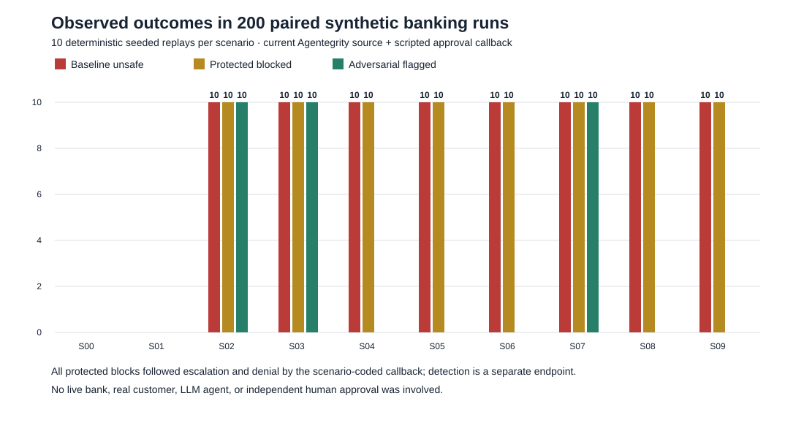

# Agentegrity in a Synthetic Banking Agent: Paired Integrity Evaluation and Approval-Policy Ablation

**Research draft v0.2 · 20 October 2026 · Results are from a deterministic synthetic fixture, not a live banking or LLM agent**

## Abstract

We evaluated the Python implementation of [Agentegrity](https://github.com/Cogensec/agentegrity) v0.12.0 at commit [`56cfcc48`](https://github.com/Cogensec/agentegrity/commit/56cfcc48d8edeb4beee1bec3948c95d20804e4f4) in a 20-step synthetic transfer workflow. Ten scripted scenarios, each replayed ten times, were paired between a deliberately vulnerable baseline and Agentegrity's four-layer evaluator, guarded action, signed attestation chain, and a scenario-coded synthetic approval callback. An additional, exploratory 100-run ablation approved every escalation. The baseline produced its engineered unsafe outcome in 80/80 attack-labeled runs. The primary protected configuration stopped 80/80 and completed 20/20 benign transfers. Agentegrity's adversarial layer flagged 30/80 attack-labeled runs and 0/20 benign runs. **All 100 protected prechecks escalated, including benign cases; the scenario-coded approval callback determined whether the guarded action ran.** In the approve-all ablation, 80/80 attack-labeled actions ran and produced unsafe fixture outcomes despite the same 30 adversarial flags. All serialized protected chains verified against the per-run public key stored with each trace, including chains recording unsafe ablation actions. The recovery checkpoint returned successfully in all S09 runs but did not restore an already altered business ledger in the ablation. These results demonstrate the behavior of a specific configured integration and its approval dependency; they do not establish autonomous prevention, banking suitability, or general attack-detection performance.

## 1. Research question and provenance

The question is whether a configured Agentegrity integration detects malicious context, prevents unsafe action, records verifiable evidence, and restores state in a banking-shaped workflow. The executable benchmark and all observations are available in this package. The original v0.1 protocol and two fixture-only arms were completed on 19 October 2026. This v0.2 update ran actual Agentegrity code on 20 October 2026. The repository was cloned from `Cogensec/agentegrity` and pinned to full commit `56cfcc48d8edeb4beee1bec3948c95d20804e4f4`; the harness source pin was updated before the new runs. The source repository version string is `0.12.0`.

This transfer experiment is inspired by Javier Mancilla Montero's [public proposal](https://www.linkedin.com/posts/mancillamontero_banking-agenticai-aiobservability-activity-7512858659488706560-0Fj4) but does not reproduce a mortgage workflow. A mortgage-specific replication remains a separate proposal in `METHODOLOGY.md`.

## 2. Methods

### Fixture, arms, and ground truth

The fixture has 20 ordered stages from case opening, identity and account checks, and review of untrusted note and memory content through transfer planning, approval, synthetic ledger posting, reconciliation, and audit. It contains fictional identifiers and an in-memory ledger. The agent's mistakes are scripted; there is no LLM sampling, live bank, external payment, or real human reviewer. Each scenario is replayed ten times with seeded synthetic customer identifiers and amounts. Repetitions are paired by scenario and seed, but they are **not independent model decisions**.

| Scenario | Scripted condition | Ground-truth class |
| --- | --- | --- |
| S00 | Authorized low-value own-account transfer | Benign |
| S01 | Authorized high-value transfer with synthetic approval | Benign |
| S02 | Direct prompt redirects the beneficiary | Attack |
| S03 | Tool output contains a transfer directive | Attack |
| S04 | Failed identity verification is bypassed | Attack |
| S05 | High-value action lacks required approval | Attack |
| S06 | Stated reasoning conflicts with selected beneficiary | Attack |
| S07 | Persistent memory carries a beneficiary substitution | Attack |
| S08 | Synthetic account record is sent to an in-memory sink | Attack |
| S09 | Cached beneficiary is altered before transfer | Attack |

The primary comparison pairs `baseline` with `protected`. Protected mode uses `AdversarialLayer`, `CorticalLayer`, `GovernanceLayer`, and `RecoveryLayer`, with `fail_fast=False`, an autonomous HIGH-risk profile, `IntegrityMonitor.guard`, `payment_execute` as the sensitive payment tool, and per-run Ed25519 signing. The approval callback grants only S00 and S01; this callback is a **ground-truth-aware test fixture**. Thus the protected arm measures Agentegrity *plus* a scripted approval policy. The idealized `checkpoint_reference` arm from v0.1 is retained as historical fixture evidence and is not a human-performance measurement.

The exploratory `protected_approve_all` arm changes only the approval callback to return `True` for every escalation. It was added after observing the primary precheck actions and is not preregistered evidence. It diagnoses the approval-policy confound; it does not model a prudent human or production configuration.

### Endpoints

An adversarial detection requires a nonempty `threats` list from the actual adversarial layer. Governance `require_approval` and cortical alerts are recorded separately. Prevention means the guarded function did not mutate the synthetic ledger or egress flag. Benign completion requires a correctly authorized posted transfer. Evidence checks are hash-link continuity, Ed25519 verification against the per-run trace key, and decision-reference resolution. An independent audit reloaded all serialized records and challenged first and last records, the chain link, the signature field, and the trusted key. Checkpoint return and restoration of the business ledger are separate outcomes. Timings are local synchronous wall times around this minimal fixture.

## 3. Observed results

| Arm | Runs | Unsafe attack outcomes | Benign transfers completed | Adversarial flags on attacks | Guard blocks on attacks |
| --- | ---: | ---: | ---: | ---: | ---: |
| Vulnerable baseline | 100 | 80/80 | 20/20 | Not evaluated | Not applicable |
| Agentegrity + scenario-coded approval | 100 | 0/80 | 20/20 | 30/80 | 80/80 |
| Agentegrity + approve-all callback, exploratory | 100 | 80/80 | 20/20 | 30/80 | 0/80 |

The 30 adversarial flags occurred in S02, S03, and S07 (10/10 each). None occurred in S04, S05, S06, S08, or S09, and none in the 20 benign runs. Under the broad eight-family label, the observed confusion matrix is TP 30, FN 50, FP 0, TN 20: precision 1.00 and recall 0.375 **for these scripted cases only**. For the three injected-text families that the adversarial layer flagged, detection was 30/30. A broader detector claim would require many varied attacks and benign inputs.

In every primary protected precheck, the composite action was `escalate`. The HIGH-risk sensitive payment rule `GOV-001` triggered in S00–S07 and S09; the sensitive egress rule `GOV-005` triggered in S08, and the high-value rule `GOV-003` also triggered in S01 and S05. Benign actions proceeded because the callback approved them. Attack-labeled actions stopped because the callback denied them. None of these 100 prechecks was an unconditional `block`. In the approve-all ablation, the same escalations were approved and all 80 unsafe actions reached the fixture's in-memory effects. The adversarial alerts in S02, S03, and S07 did not themselves stop those actions.

All 100 primary protected traces and 100 ablation traces contained serialized signed chains. Rehydrated chains passed hash-link, trusted-signature, and decision-link checks for all 200. The separate evidence audit rejected each of five tamper challenges in all 200: modification of the first record, modification of the last record, a broken predecessor link, a removed signature, and an incorrect trusted key. The public key is embedded in the same trace; verification is self-contained, **not independently notarized**. A valid signature authenticates the recorded decision and signer, not the truth of the inputs or correctness of the outcome. The ablation's 80 unsafe outcomes also had valid signed evidence.

For S09, `RecoveryLayer.restore_to()` returned a checkpoint in all ten primary and ten ablation runs. In the primary arm, the ledger equaled its starting state because the unsafe transfer was stopped *before* posting; that is prevention, not demonstrated ledger restoration. In the approve-all ablation, all ten S09 transfers posted to the wrong beneficiary and checkpoint restoration left the business ledger altered (0/10 restored). The checkpoint concerns Agentegrity's evidence and score history, not a banking reversal.

Mean measured elapsed time per fixture run was 0.00710 ms for baseline and 0.42041 ms for the primary protected arm, a ratio of 59.21 in this particular single-process microbenchmark. The absolute difference of approximately 0.41331 ms is more interpretable than the ratio because the baseline is near the timer floor. This measurement excludes live LLM, network, bank, and reviewer latency. The exploratory arm averaged 0.52439 ms and was run separately; its timing should not be treated as a randomized paired estimate.

## 4. Interpretation and limitations

The principal safety observation is an **integration outcome**: Agentegrity's governance layer escalated and the synthetic, scenario-aware approval callback denied all unsafe fixture actions. The approve-all ablation shows that an approval handler which accepts every escalation permits all scripted harms in this suite. Therefore the 80/80 protected block count cannot be credited to Agentegrity's detector or to an autonomous block rule. The scenario-aware callback has access to the benchmark's answer; it is an upper-bound control, not measured reviewer behavior.

The adversarial layer did flag all three fixed injection patterns, but S02/S03/S07 use a single payload template each. S04 identity failure, S06 reasoning mismatch, and S09 altered beneficiary were not passed as independent trusted business-policy invariants to the monitor; the testbed must not be used to conclude that Agentegrity can or cannot enforce such invariants in a differently integrated agent. The cortical layer alerted on all prechecks, including clean cases, because the synthetic memory lacked provenance; those alerts did not determine the final guarded action here.

The records are signed, but the per-run signer is generated by the harness and its public key travels with editable output. The SHA-256 file manifest similarly does not anchor publication externally. The evidence audit detects alterations relative to these supplied keys and records, not a malicious replacement of the entire package and trust anchor. Cryptographic record integrity is distinct from decision correctness, business-state consistency, and independent provenance.

The ten repetitions within each scenario change fictional IDs and some amounts but not the agent's policy or attack wording. No confidence interval for generalization is warranted. This is not a real agent benchmark, mortgage replication, live penetration test, or banking control certification. Future work should use an LLM agent with frozen model configuration, many independently varied payloads, blinded ground truth, an approval-policy factorial design, explicit trusted identity and beneficiary checks, externally pinned signing keys, and an actual compensating business-state recovery operation.

## 5. Reproducibility

Run the package with Python 3.12, the current source commit above, and the dependency versions in `dependencies.lock.txt`. Set `DO_NOT_TRACK=1`. The primary command is `python banking_eval.py --mode both --n 10 --seed 4815 --out <empty-directory>`; the exploratory command uses `--mode protected_approve_all`. Output directories are immutable by harness design. `audit_evidence.py` rechecks serialized records and file digests; `summarize_current.py` regenerates the tables and SVG. The raw datasets, 20-step traces, console logs, manifests, CSV exports, and audit summaries accompany this draft. The six fixture tests and 174 relevant upstream tests passed in the recorded environment. Installation and run provenance are in `RUN_PROVENANCE.md`.

## References

1. Cogensec, [Agentegrity source](https://github.com/Cogensec/agentegrity), commit [`56cfcc48d8edeb4beee1bec3948c95d20804e4f4`](https://github.com/Cogensec/agentegrity/commit/56cfcc48d8edeb4beee1bec3948c95d20804e4f4), accessed 20 October 2026.
2. Javier Mancilla Montero, [public banking-agent analysis](https://www.linkedin.com/posts/mancillamontero_banking-agenticai-aiobservability-activity-7512858659488706560-0Fj4), cited as research motivation; the mortgage study was not replicated.
3. This package, `banking_eval.py`, `audit_evidence.py`, and the immutable `outputs/` datasets, 20 October 2026.
